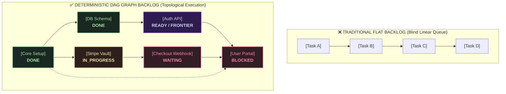

<div align="center">

# tare.tools.backlog-graph

**Motor determinístico de backlog em grafo acíclico dirigido (DAG) e framework de execução topológica para equipes de engenharia de software e agentes autônomos de IA.**

[](https://opensource.org/licenses/Apache-2.0)
[](https://python.org)
[-orange.svg)](#instalação-e-início-rápido)
[](https://github.com/augusto-scarvalho/tare.tools.backlog-graph/actions/workflows/ci.yml)

<p align="center">
  <a href="#por-que-backlog-em-grafo-a-mudança-de-paradigma">Por que backlog em grafo</a> •
  <a href="#pilares-arquiteturais">Recursos</a> •
  <a href="#ingestão-de-backlogs-de-terceiros">Integrações e adaptadores</a> •
  <a href="#instalação-e-início-rápido">Início rápido</a> •
  <a href="#referência-de-comandos-da-cli">Referência da CLI</a> •
  <a href="#api-da-biblioteca-python">Biblioteca Python</a> •
  <a href="#mission-control-interativo-e-copilot-bridge">Interface interativa</a> •
  <a href="CHANGELOG.md">Changelog</a> •
  <a href="#licença-e-atribuição">Licença</a>
</p>

<p align="center">
  🇺🇸 <a href="README.md">Read in English</a>
</p>

</div>

---

## Por que backlog em grafo? (A mudança de paradigma)

A entrega de software moderna é um **grafo topológico de dependências**, não uma lista plana nem uma coluna de Kanban sem restrições.

Quando agentes autônomos de IA (Copilot, Claude, Devin) e equipes com vários desenvolvedores trabalham em bases de código complexas usando gerenciadores de tarefas tradicionais (Jira, Linear, GitHub Projects), enfrentam três falhas sistêmicas:

1. **Cegueira de bloqueios:** não fica evidente qual tarefa desbloqueia os marcos seguintes nem por que uma tarefa de alta prioridade não pode começar.
2. **Priorização às cegas:** itens de prioridade crítica (`P0`) ficam parados com frequência porque pré-requisitos de baixa prioridade foram esquecidos ou enterrados no backlog.
3. **Alucinação da fronteira de execução:** agentes e engenheiros precisam adivinhar o que é de fato viável implementar *agora* sem quebrar dependências contratuais.



### Análise comparativa

| Capacidade | Listas planas e Kanban linear | tare.tools Graph Backlog |
|---|---|---|
| **Fronteira de execução (`frontier`)** | Adivinhação manual | **Cálculo matemático determinístico** (todos os pré-requisitos comprovadamente satisfeitos) |
| **Análise de causa raiz (`why`)** | Leitura manual dos comentários do ticket | **Resolução automática de bloqueios e árvore de dependências** |
| **Caminho crítico (`critical-path`)** | Não computável | **Identificação exata da cadeia de gargalos mais longa** |
| **Pacotes de implementação para agentes (`packet`)** | Copiar e colar descrições de issues | **Contexto Markdown compilado com DoD e grounding** |
| **Cerca de trabalho gerenciado (`ground`)** | O agente confia numa fotografia obsoleta do ticket | **Contexto de execução somente leitura, limitado e cercado por hash** |
| **Simulação what-if (`simulate`)** | Impossível sem alterar o estado de produção | **Projeção topológica contrafactual sobreposta** |
| **Auditoria e governança (`ledger`)** | Transições de estado destrutivas | **Trilha de auditoria append-only encadeada por SHA-256** |
| **Dependências de execução** | Servidor pesado ou SDKs complexos | **Zero dependências externas (Python 3.10+ puro, só stdlib)** |

---

## Pilares arquiteturais

### 1. Fronteira pronta determinística
Calcula o subconjunto exato de nós não concluídos cujas dependências a montante estão 100% satisfeitas (`DONE` com a Definition of Done verificada). Agentes e desenvolvedores sempre puxam trabalho matematicamente válido.

### 2. Motor de priorização multicritério
Ordena o trabalho elegível da fronteira com uma pontuação determinística que equilibra prioridade de negócio (`P0`–`P3`), horizonte de execução (`H0`–`H4`) e impacto de desbloqueio a jusante (unlock score).

### 3. Rastreamento de bloqueios e de impacto
- **`why <id>` e `blockers <id>`:** apontam os gargalos de pré-requisito que impedem uma tarefa de avançar.
- **`impact <id>` e `deps <id>`:** rastreiam todo o alcance topológico a jusante e a montante por todas as relações transitivas.
- **`path <a> <b>`:** calcula o menor caminho de dependências entre duas tarefas.

### 4. Compilador de pacotes de implementação
Compila pacotes de implementação em Markdown, autocontidos e densos, prontos para prompts de LLM, agentes auxiliares e pipelines de revisão automática de código.

### Grounding de trabalho gerenciado
`ground <id>` emite JSON canônico e limitado em bytes somente para trabalho
operacionalmente pronto e com critérios de saída explícitos. O digest do escopo
de execução muda quando mudam o item, suas relações incidentes, pré-requisitos
diretos ou fontes referenciadas, permitindo que um runtime gerenciado pare diante
de drift. O comando não concede Authority nem escreve no backlog canônico. Veja
[`docs/MANAGED_WORK_GUARD.md`](docs/MANAGED_WORK_GUARD.md).

### 5. Simulação contrafactual "what-if"
Simula o impacto a jusante de marcar tarefas candidatas como concluídas *antes de escrever código*, projetando exatamente quais tarefas serão desbloqueadas em seguida.

### 6. Ledger de auditoria à prova de adulteração (cadeia de hashes)
Mantém um ledger de eventos append-only em que o `event_hash` de cada evento é o SHA-256 do seu corpo em JSON canônico, e esse corpo inclui o hash do evento anterior (`prev_hash`). Editar ou remover um evento anterior quebra a cadeia.

### 7. Doctor do grafo e auditorias de integridade automáticas
Detecta ciclos topológicos (componentes fortemente conexos de Tarjan), referências de arestas pendentes, requisitos órfãos e lacunas epistêmicas nos graus de evidência.

---

## Ingestão de backlogs de terceiros

Importe backlogs reais de ferramentas existentes com pipelines de CLI padrão e **zero dependências externas**:

```bash
# GitHub Issues (lê pela GitHub CLI ou por um export JSON)
gh issue list --limit 100 --json number,title,body,labels,state | python graph_ops.py import-github --out work-graph.json

# Linear (lê um export CSV do Linear ou JSON da API GraphQL)
python graph_ops.py import-linear linear-export.csv --out work-graph.json

# GitLab Issues (lê pela GitLab CLI ou por um export JSON)
glab issue list --output json | python graph_ops.py import-gitlab --out work-graph.json

# Jira Cloud e Server (lê um export CSV do Jira ou o JSON de busca da API REST)
python graph_ops.py import-jira jira-export.csv --out work-graph.json

# Listas de tarefas em Markdown (lê checklists com anotações de dependência)
python graph_ops.py import-md backlog.md --out work-graph.json
```

---

## Instalação e início rápido

### O que você precisa
- Python 3.10 ou mais novo. O motor usa apenas a biblioteca padrão.
- Git, para clonar o repositório.
- Para os testes: `pytest` (instalado pelo extra `dev` abaixo).

### Rodar sem instalar
`graph_ops.py` coloca `src/` no caminho de importação, então um clone novo roda direto:
```bash
git clone https://github.com/augusto-scarvalho/tare.tools.backlog-graph.git
cd tare.tools.backlog-graph

# Resumo do grafo
python graph_ops.py --graph fixtures/sample-backlog.json summary

# Fronteira de execução pronta
python graph_ops.py --graph fixtures/sample-backlog.json frontier --format ids

# Tarefa mais recomendada
python graph_ops.py --graph fixtures/sample-backlog.json next --limit 1
```

### Instalar como pacote
Num ambiente virtual, a partir da raiz do repositório:
```bash
python -m venv .venv
# Windows: .venv\Scripts\activate    macOS/Linux: source .venv/bin/activate
python -m pip install -e ".[dev]"
```
Depois da instalação, os comandos `backlog`, `graph-backlog` e `graph-ops` ficam disponíveis no ambiente. São a mesma CLI que `python graph_ops.py`.

---

## Referência de comandos da CLI

Todo comando lê o grafo indicado por `--graph <arquivo>` (padrão: `work-graph.json` no diretório atual). Os exemplos abaixo supõem esse arquivo; acrescente `--graph fixtures/sample-backlog.json` para testá-los no exemplo incluído.

| Subcomando | Função e saída | Exemplo de uso |
|---|---|---|
| `validate` | Valida o schema do grafo, a integridade do DAG e a ausência de ciclos | `python graph_ops.py validate` |
| `summary` | Calcula contagens por cluster, status e fronteira | `python graph_ops.py summary` |
| `frontier` | Calcula todas as tarefas prontas, com dependências satisfeitas | `python graph_ops.py frontier --format ids` |
| `next` | Ordena as tarefas acionáveis por prioridade, horizonte e unlock score | `python graph_ops.py next --limit 3` |
| `why <id>` | Explica por que uma tarefa está pronta ou bloqueada, listando os pré-requisitos | `python graph_ops.py why TASK-03` |
| `blockers <id>` | Lista os bloqueios diretos de pré-requisito não satisfeitos | `python graph_ops.py blockers TASK-03` |
| `deps <id>` | Calcula todas as dependências transitivas a montante | `python graph_ops.py deps TASK-03 --format md` |
| `impact <id>` | Calcula todos os dependentes a jusante desbloqueados por `<id>` | `python graph_ops.py impact TASK-01` |
| `path <a> <b>` | Calcula o menor caminho de dependências de `A` até `B` | `python graph_ops.py path TASK-01 TASK-03` |
| `critical-path` | Calcula a sequência de gargalos mais longa do DAG | `python graph_ops.py critical-path` |
| `packet <id>` | Compila contexto Markdown autocontido para agentes de IA | `python graph_ops.py packet TASK-02 --format md` |
| `ground <id>` | Emite JSON operacional limitado e uma cerca de escopo de execução | `python graph_ops.py --format json ground TASK-02 --work-graph fixtures/sample-backlog.json` |
| `simulate` | Projeta as mudanças na fronteira ao concluir trabalho candidato | `python graph_ops.py simulate --complete TASK-02` |
| `diff <other>` | Calcula o diff semântico profundo entre duas fotografias do grafo | `python graph_ops.py diff previous-graph.json` |
| `doctor` | Roda a auditoria de estrutura, ciclos, evidências e reconciliação | `python graph_ops.py doctor` |
| `export` | Exporta para o visualizador HTML autônomo, JSON, Markdown, Mermaid, CSV ou GraphML | `python graph_ops.py export -o index.html --export-format html` |
| `visualize` | Inicia um servidor web local com a interface interativa do DAG | `python graph_ops.py visualize --port 8080` |
| `import-github` | Importa JSON do GitHub Issues ou stdin para o grafo | `python graph_ops.py import-github issues.json` |
| `import-linear` | Importa exports CSV ou JSON do Linear | `python graph_ops.py import-linear export.csv` |
| `import-gitlab` | Importa JSON do GitLab Issues ou stdin para o grafo | `python graph_ops.py import-gitlab gitlab.json` |
| `import-jira` | Importa um export CSV do Jira ou o JSON de busca da API REST | `python graph_ops.py import-jira jira.csv` |
| `import-md` | Importa listas de tarefas estruturadas em Markdown (`backlog.md`) | `python graph_ops.py import-md backlog.md` |

A lista completa, incluindo os comandos de mutação (`add-node`, `complete-node`, `land`, `supersede`), está em [docs/CLI_REFERENCE.md](docs/CLI_REFERENCE.md) (em inglês).

---

## API da biblioteca Python

Use `graph_backlog` como motor Python embutido em agentes, orquestradores e scripts de CI:

```python
from graph_backlog import (
    WorkGraph,
    compute_frontier,
    ranked_next,
    generate_packet,
    critical_path,
    simulate_completions
)
from graph_backlog.packet import format_packet_markdown

# 1. Carregar o grafo de trabalho
graph = WorkGraph.from_file("fixtures/saas-backlog.json")

# 2. Calcular a fronteira de execução acionável
ready_tasks = compute_frontier(graph)
print(f"Ready to execute: {[t['id'] for t in ready_tasks]}")

# 3. Ordenação determinística
top_work = ranked_next(graph, limit=1)
target_task_id = top_work[0]["id"]
print(f"Next recommended task: {target_task_id} (Score: {top_work[0]['score']})")

# 4. Gerar o pacote de implementação para o prompt de IA
packet = generate_packet(graph, target_task_id)
markdown_prompt = format_packet_markdown(packet)
print(markdown_prompt)

# 5. Simulação contrafactual what-if
sim = simulate_completions(graph, [target_task_id])
print(f"Newly unlocked tasks: {sim['newly_unlocked_nodes']}")
```

---

## Mission Control interativo e Copilot Bridge

O projeto inclui um **visualizador HTML interativo e autônomo, sem framework**. `export --export-format html` e `visualize` o geram para qualquer grafo; [`visualizer/index.html`](visualizer/index.html) é uma cópia pronta que abre no grafo sintético `fixtures/work-graph-v0.5.json` e também traz os backlogs de demonstração:

- **3 modos de canvas:** canvas físico dinâmico do DAG, quadro Kanban e clusters de domínio.
- **12 temas:**
  - *Escuros:* Signal Mission Control (padrão), Dracula, Tokyo Night, Nord Frost, Monokai Pro, Catppuccin Mocha.
  - *Claros:* Solar Paper, Solarized Light, GitHub Light, Nord Snow Storm, Catppuccin Latte, Gruvbox Light.
- **Estação de operações do grafo:** janela modal com ferramentas de análise, sandbox de simulação what-if e o ledger encadeado por hash.

### Descoberta por agentes de IA no navegador e Copilot Bridge

O visualizador expõe o grafo a assistentes de IA no navegador e a scripts do DevTools:

1. **API global de runtime (`window.tareGraph`):**
   ```javascript
   // Consulte o resumo do grafo e a fronteira pronta direto no console do DevTools ou no runtime do agente:
   window.tareGraph.getSummary();
   window.tareGraph.getFrontier();
   window.tareGraph.getCriticalPath();
   window.tareGraph.simulate(["AUTH-01"], true);
   ```
2. **Manifesto JSON no DOM:** `<script id="signal-agentic-manifest" type="application/json">`, sincronizado em tempo real, permite que coletores de IA leiam a estrutura topológica sem interpretar elementos SVG.
3. **Prompts de contexto:** gera prompts de briefing prontos para o Copilot, resumindo os gargalos ativos e as tarefas prontas.

---

## CI/CD e orquestração de agentes autônomos

### Workflow de auditoria de PR (GitHub Actions)
```yaml
name: Work Graph Quality Gate
on: [pull_request, push]

jobs:
  graph-audit:
    runs-on: ubuntu-latest
    steps:
      - uses: actions/checkout@v4
      - uses: actions/setup-python@v5
        with:
          python-version: '3.12'
      - name: Validate DAG & Check Cycles
        run: |
          python graph_ops.py --graph work-graph.json doctor
          python graph_ops.py --graph work-graph.json validate
```

### Fornecer contexto a agentes de LLM (Claude / Devin / Copilot)
```bash
# Extrai a tarefa pronta mais bem ranqueada e compila o contexto do prompt:
NEXT_ID=$(python graph_ops.py frontier --format ids | head -n 1)
python graph_ops.py packet $NEXT_ID --format md > .agent/current-context.md
```

---

## Uso no tare.tools.os

O [tare.tools.os](https://github.com/augusto-scarvalho/tare.tools.os) fixa este repositório como submódulo Git em
`satellites/tare.tools.backlog-graph` e o instala como o pacote `tare-tools-backlog-graph`. O OS o usa para validar o
grafo de trabalho, calcular hashes de revisão e fazer transações compare-and-swap no grafo, para ranking e prontidão, e
para o grounding de trabalho gerenciado. Este repositório continua utilizável sozinho: nada aqui importa o OS.

---

## Estrutura do repositório

```text
tare.tools.backlog-graph/
├── README.md / README.pt-BR.md    # Documentação em inglês e em português do Brasil
├── LICENSE, NOTICE                # Apache License 2.0 e atribuição
├── CHANGELOG.md                   # Registro append-only de mudanças
├── pyproject.toml                 # Configuração do pacote
├── graph_ops.py                   # CLI executável direto, sem configuração
├── src/
│   └── graph_backlog/             # Pacote Python principal
│       ├── core.py                # Modelo de dados (WorkGraph) e carga da política padrão
│       ├── algorithms.py          # Fronteira, ciclos (SCC de Tarjan), caminhos, ranking
│       ├── validation.py          # Validação estrutural, de schema e de integridade
│       ├── mutations.py           # Transações compare-and-swap do grafo, com lock
│       ├── grounding.py           # Grounding de trabalho gerenciado (`ground`)
│       ├── diff.py                # Diff semântico e verificação de mutações
│       ├── ledger.py              # Ledger de auditoria append-only encadeado por hash
│       ├── simulation.py          # Sobreposições contrafactuais what-if
│       ├── packet.py              # Compilador de pacotes de implementação
│       ├── adapters.py            # Adaptadores GitHub, Linear, GitLab, Jira, Markdown, Mermaid, CSV, GraphML
│       ├── visualizer.py          # Exportador HTML e visualizador web interativo
│       ├── cli.py                 # Parser de argumentos e despacho da CLI
│       └── contracts/             # Cópias empacotadas das políticas e schemas
├── policies/, schemas/            # Taxonomia de relações, política graph-ops, JSON schemas
├── ontology/                      # Ontologia de domínio legível por máquina
├── docs/                          # Arquitetura, ontologia, referência da CLI, guias (veja docs/INDEX.md)
├── fixtures/                      # Grafos de trabalho sintéticos usados em testes e demos
│   ├── sample-backlog.json        # Backlog inicial com 3 nós
│   ├── work-graph-v0.5.json       # Exemplo completo do schema v0.5 (app de notas fictício)
│   ├── saas-backlog.json          # Backlog SaaS CloudPulse (33 nós)
│   ├── crm-rag-chatbot-backlog.json # Backlog de pipeline RAG de IA (27 nós)
│   ├── transmedia-book-comic-film-backlog.json # Saga transmídia (42 nós)
│   └── negative-*.json            # Um defeito cada: aresta pendente, self loop, status inválido, ...
├── visualizer/index.html          # Visualizador autônomo pré-gerado
├── scripts/                       # Diagnóstico do grafo, quebra de ciclos, relatório de topologia
├── tools/                         # Guard do changelog e instalador de hooks Git
└── tests/                         # Suíte de testes offline
```

Todos os grafos em `fixtures/` são sintéticos. [docs/guides/REPOSITORY_CONTENT.md](docs/guides/REPOSITORY_CONTENT.md)
(em inglês) explica o que a árvore contém e onde estão listados os registros históricos removidos.

---

## Testes automatizados

Com o extra `dev` instalado (veja [Instalar como pacote](#instalar-como-pacote)), rode os mesmos comandos do CI:
```bash
# Canários herméticos de mutação (alguns minutos)
python -m pytest tests/test_mutation_testing.py -v

# Suíte principal de testes
python -m pytest tests/ -v --ignore=tests/test_mutation_testing.py

# Testes do guard do changelog
python -m unittest discover -s tools/tests -p "test_changelog_guard.py"
```

Os testes são offline e usam apenas as fixtures incluídas e diretórios temporários. O teste ponta a ponta no navegador
em `tests/test_e2e_visualizer.py` é pulado se o Playwright não estiver instalado.

Os canários limitados de PR e as campanhas manuais mais amplas de mutação estão documentados
em [docs/MUTATION_TESTING.md](docs/MUTATION_TESTING.md) (em inglês).

---

## Licença e atribuição

Licenciado sob a **Apache License, Version 2.0**. Veja os arquivos [LICENSE](LICENSE) e [NOTICE](NOTICE).

### Autor
- **Autor:** Augusto Carvalho ([augusto-scarvalho@users.noreply.github.com](mailto:augusto-scarvalho@users.noreply.github.com))
- **Projeto:** [tare.tools.backlog-graph](https://github.com/augusto-scarvalho/tare.tools.backlog-graph)
- **Origem:** extraído do protótipo de pesquisa do harness de agentes do tare.tools.
